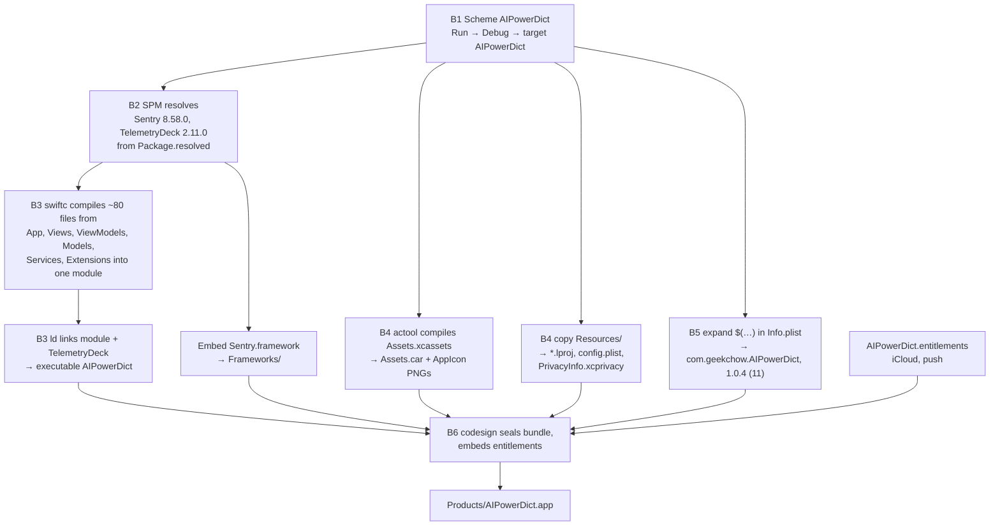
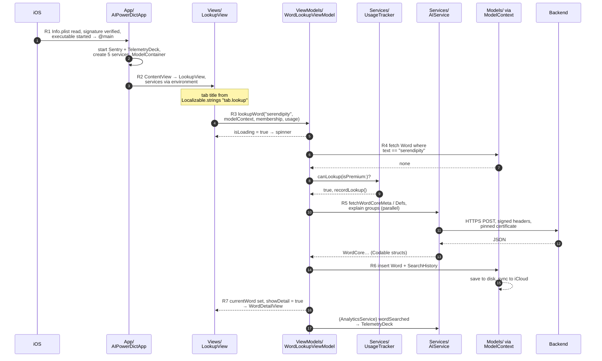

# 6 — Full Walkthrough

> **Where you are:** stage six. The running example again, end to end, with everything from the deep dives filled in.
> **What you'll know after this file:** how every entry in the navigator takes part in one build, one lookup and one test, as a single connected story.

Step numbers are those from [04 — Running example](04-running-example.md).

## Part 1: build time

*What does each navigator entry turn into, and which tool does it?*

**B1.** You press Run. Xcode opens `AIPowerDict.xcscheme`, finds the Run action, and learns: Debug configuration, target `AIPowerDict`, launch its product, use `StoreKit.storekit` for purchases. Build settings are resolved through their layers: `SWIFT_VERSION = 6.2`, `IPHONEOS_DEPLOYMENT_TARGET = 18.0`, `MARKETING_VERSION = 1.0.4`.

**B2.** The project lists two package rules. `Package.resolved` already pins Sentry 8.58.0 and TelemetryDeck 2.11.0, so SPM (Swift Package Manager) fetches exactly those into `DerivedData` and builds them.

**B3.** The Compile Sources phase gives every member Swift file to `swiftc` as one module. `Views/Lookup/LookupView.swift`, `ViewModels/WordLookupViewModel.swift`, `Services/AIService.swift` and `Models/Word.swift` are now parts of the same unit; the folder names are gone. The linker produces the executable `AIPowerDict`, with TelemetryDeck's code inside and a load reference to `Sentry.framework`.

**B4.** `actool` turns `AppIcon.appiconset` and `AccentBlue.colorset` into `Assets.car` and the icon files. The Copy Bundle Resources phase places `en.lproj/Localizable.strings`, `zh-Hans.lproj/…`, `zh-Hant.lproj/…`, `config.plist` and `PrivacyInfo.xcprivacy` at the top of the bundle.

**B5.** `Info.plist` is processed: `$(PRODUCT_BUNDLE_IDENTIFIER)` becomes `com.geekchow.AIPowerDict`, `$(MARKETING_VERSION)` becomes `1.0.4`, `$(CURRENT_PROJECT_VERSION)` becomes `11`. The four usage descriptions, the `aipowerdict` URL scheme and the scene manifest pass through unchanged.

**B6.** `codesign` signs `Sentry.framework`, then the app. It hashes every file into `_CodeSignature/CodeResources` and embeds the four entitlement keys into the executable's signature. `AIPowerDict.app` appears under Products. Xcode installs it and asks the simulator to launch it.

## Part 2: run time

*What crosses each boundary when the user looks up "serendipity"?*

**R1.** iOS reads `CFBundleExecutable` from the bundle's `Info.plist`, verifies the signature, loads `Sentry.framework`, and starts the process. Control reaches `@main struct AIPowerDictApp`. Its `init()` starts TelemetryDeck with the ID that `Config` reads from `config.plist`, then Sentry. The five `@State` services are created. `sharedModelContainer` is created for the schema of five model types.

**R2.** `body` builds `WindowGroup { ContentView() }` with the services and the model container injected. `ContentView` creates `lookupViewModel` and shows `LookupView`. Each tab label is resolved from the key `tab.lookup` and its siblings to the `.lproj` folder for the current language.

**R3.** Typing writes to `viewModel.searchText` through a binding. Submitting calls `lookupWord`, passing the `modelContext`, `MembershipService` and `UsageTracker` that the view took from the environment. The view's work is done.

**R4.** The view model lowercases and trims the text, sets `isLoading = true` (the view redraws with a spinner because it observed that property), and runs a `FetchDescriptor<Word>` with a predicate on `text`. No cached entry. It asks `usage.canLookup(isPremium: membership.isPremium)`; allowed, so `usage.recordLookup()`.

**R5.** The view model starts several `AIService` calls in parallel. For each, the service reads the backend address through `Config`, lets `RequestSigner` compute HMAC-SHA256 headers, and sends through a `URLSession` whose delegate is `CertificatePinner`. Replies are decoded into `Codable` structs. If anything fails here, the error is thrown back, the view model sets `errorMessage`, and the view shows the retry page instead of step R7.

**R6.** The view model creates a `Word`, copies in pronunciation, definitions, examples and etymology as they arrive, and inserts it into the `ModelContext` along with a `SearchHistory` entry. SwiftData persists both. On a device, the container's `cloudKitDatabase: .private("iCloud.geekchow.aipowerdict")` setting mirrors them to iCloud, which the kernel allows because the signature carries the matching entitlement.

**R7.** `currentWord`, `isLoading = false`, `showDetail = true`. SwiftUI redraws: `WordDetailView` slides in. The recent-searches list behind it has already updated through `@Query`. `AnalyticsService.wordSearched(source: .text, cacheHit: false)` emits a TelemetryDeck signal.

### The edge flow: cache hit

Look up "serendipity" a second time. R4's fetch returns the stored `Word`, the view model sets `currentWord` and `showDetail` immediately, and returns. Steps R5 and R6 do not happen: no quota use, no network, works offline. Only `Views`, `ViewModels` and `Models` took part.

## Part 3: test time

**T1.** Press ⌘U. The scheme's Test action builds the app (B1–B6 again) and the second target into `AIPowerDictUITests.xctest`. A runner process launches the app with `-AppleLanguages (zh-TW)`. Part 2's R1 and R2 replay inside the app, this time resolving `tab.lookup` from `zh-Hant.lproj`. The test asks the accessibility system whether a static text "查詞" exists, and passes.

## Every entry, seen at work

| Navigator entry | Seen doing its job at |
|---|---|
| Project and scheme | B1 |
| `AIPowerDict.entitlements` | B6, R6 |
| `Assets.xcassets` | B4, R2 |
| `Info.plist` | B5, R1 |
| `App/` | R1, R2 |
| `Extensions/` | compiled at B3; helpers such as `Color(hex:)` used while drawing at R2 |
| `Models/` | R4, R6 |
| `Resources/` | B4, R1 (`config.plist`), R2 (strings) |
| `Services/` | R4, R5, R7 |
| `ViewModels/` | R3, R4, R6, R7 |
| `Views/` | R2, R3, R7 |
| `AIPowerDictUITests` | T1 |
| `Products` | B6 |
| `Package Dependencies` | B2, R1, R7 |

## Recap

[Stage one](01-why.md) named four pressures. The walkthrough answered each. *Many inputs, one signed bundle*: a scheme and a target turned some ninety source and resource files and two packages into `AIPowerDict.app` in six steps. *Facts before code*: `Info.plist` and the entitlements told iOS what to launch and what to allow before `@main` ran. *Navigable code*: one user action passed through View, ViewModel, Service and Model in order, each doing one kind of work, and the cache-hit variant skipped a whole layer without anyone else noticing. *Reuse and verification*: two packages did crash reporting and analytics, and a separate test product replayed the launch from outside.

---
Next → [07 — Pitfalls and next steps](07-next-steps.md) · Back to [concept map](03-concept-map.md)
